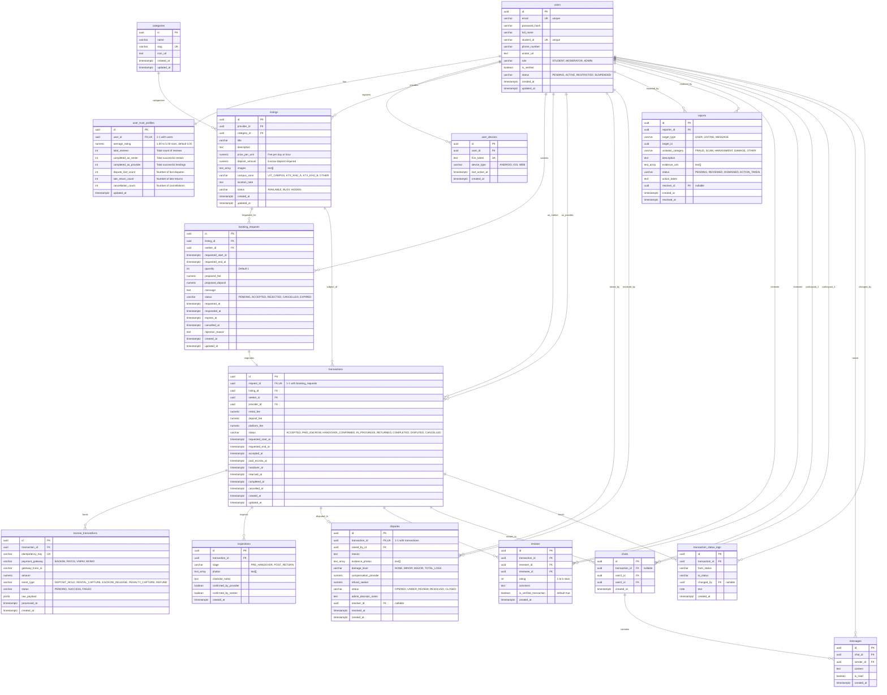

# Sơ đồ Thực thể Liên kết (Entity Relationship Diagram - ERD)
> **Dự án:** ImFree – Nền tảng chia sẻ thiết bị ngang hàng dành cho sinh viên (P2P Campus Asset Rental)  
> **Cuộc thi:** Advanced Information Systems Contest 2026 (AISC'26) - UIT  
> **Cơ sở dữ liệu:** PostgreSQL 16  
> **Kiến trúc Tinh gọn (Lean):** Tập trung 100% vào Thiết bị (Asset), Bỏ Trust Score trừu tượng, thay thế bằng Đánh giá 1 - 5 Sao (⭐) và Hồ sơ Uy tín Thực tế.

---

## 1. Sơ đồ ERD trực quan (Mermaid Diagram)



---

## 2. Mã DBML Chuẩn hóa (Copy trực tiếp vào [dbdiagram.io](https://dbdiagram.io))

```dbml
Project ImFree {
  database_type: "PostgreSQL"
  Note: "ImFree - Nền tảng chia sẻ thiết bị ngang hàng dành cho sinh viên (P2P Asset Rental)"
}

/* =========================================================
   1. USERS & TRUST PROFILE (5-STAR RATING)
   ========================================================= */

Table users {
  id uuid [pk]

  email varchar(255) [not null, unique]
  password_hash varchar(255) [not null]

  full_name varchar(150) [not null]
  student_id varchar(30) [not null, unique]
  phone_number varchar(20)
  avatar_url text

  role varchar(20) [not null, default: 'STUDENT',
    note: 'STUDENT, MODERATOR, ADMIN'
  ]

  is_verified boolean [not null, default: false]

  status varchar(20) [not null, default: 'PENDING',
    note: 'PENDING, ACTIVE, RESTRICTED, SUSPENDED'
  ]

  created_at timestamptz [not null, default: `now()`]
  updated_at timestamptz [not null, default: `now()`]

  Indexes {
    email
    student_id
    status
  }
}

Table user_trust_profiles {
  id uuid [pk]

  user_id uuid [not null, unique]

  average_rating numeric(3,2) [not null, default: 5.00,
    note: 'Average rating from 1.00 to 5.00 stars'
  ]
  total_reviews int [not null, default: 0]

  completed_as_renter int [not null, default: 0]
  completed_as_provider int [not null, default: 0]

  dispute_lost_count int [not null, default: 0]
  late_return_count int [not null, default: 0]
  cancellation_count int [not null, default: 0]

  updated_at timestamptz [not null, default: `now()`]
}

Table user_devices {
  id uuid [pk]

  user_id uuid [not null]

  fcm_token text [not null, unique]
  device_type varchar(20) [not null,
    note: 'ANDROID, IOS, WEB'
  ]

  last_active_at timestamptz [not null, default: `now()`]
  created_at timestamptz [not null, default: `now()`]

  Indexes {
    user_id
  }
}

/* =========================================================
   2. CATEGORIES & LISTINGS (ASSET ONLY)
   ========================================================= */

Table categories {
  id uuid [pk]

  name varchar(100) [not null]
  slug varchar(100) [not null, unique]
  icon_url text

  created_at timestamptz [not null, default: `now()`]
  updated_at timestamptz [not null, default: `now()`]

  Indexes {
    slug
  }
}

Table listings {
  id uuid [pk]

  provider_id uuid [not null]
  category_id uuid [not null]

  title varchar(200) [not null]
  description text [not null]

  price_per_unit numeric(12,2) [not null, default: 0]
  deposit_amount numeric(12,2) [not null, default: 0]

  images text[]

  campus_zone varchar(30) [not null,
    note: 'UIT_CAMPUS, KTX_KHU_A, KTX_KHU_B, OTHER'
  ]

  location_note text

  status varchar(20) [not null, default: 'AVAILABLE',
    note: 'AVAILABLE, BUSY, HIDDEN'
  ]

  created_at timestamptz [not null, default: `now()`]
  updated_at timestamptz [not null, default: `now()`]

  Indexes {
    provider_id
    category_id
    status
    campus_zone
    created_at
  }
}

/* =========================================================
   3. BOOKING REQUEST
   ========================================================= */

Table booking_requests {
  id uuid [pk]

  listing_id uuid [not null]
  seeker_id uuid [not null]

  requested_start_at timestamptz [not null]
  requested_end_at timestamptz

  quantity int [not null, default: 1]

  proposed_fee numeric(12,2) [not null, default: 0]
  proposed_deposit numeric(12,2) [not null, default: 0]

  message text

  status varchar(20) [not null, default: 'PENDING',
    note: 'PENDING, ACCEPTED, REJECTED, CANCELLED, EXPIRED'
  ]

  requested_at timestamptz [not null, default: `now()`]
  responded_at timestamptz
  expires_at timestamptz
  cancelled_at timestamptz

  rejection_reason text

  created_at timestamptz [not null, default: `now()`]
  updated_at timestamptz [not null, default: `now()`]

  Indexes {
    listing_id
    seeker_id
    status
    requested_start_at
    requested_end_at
    created_at
  }
}

/* =========================================================
   4. TRANSACTIONS
   ========================================================= */

Table transactions {
  id uuid [pk]

  request_id uuid [not null, unique]

  listing_id uuid [not null]
  seeker_id uuid [not null]
  provider_id uuid [not null]

  rental_fee numeric(12,2) [not null, default: 0]
  deposit_fee numeric(12,2) [not null, default: 0]
  platform_fee numeric(12,2) [not null, default: 0]

  status varchar(30) [not null, default: 'ACCEPTED',
    note: 'ACCEPTED, PAID_ESCROW, HANDOVER_CONFIRMED, IN_PROGRESS, RETURNED, COMPLETED, DISPUTED, CANCELLED'
  ]

  requested_start_at timestamptz
  requested_end_at timestamptz

  accepted_at timestamptz [not null, default: `now()`]
  paid_escrow_at timestamptz
  handover_at timestamptz
  returned_at timestamptz
  completed_at timestamptz
  cancelled_at timestamptz

  created_at timestamptz [not null, default: `now()`]
  updated_at timestamptz [not null, default: `now()`]

  Indexes {
    listing_id
    seeker_id
    provider_id
    status
    requested_start_at
    requested_end_at
    created_at
  }
}

/* =========================================================
   5. PAYMENT / ESCROW
   ========================================================= */

Table escrow_transactions {
  id uuid [pk]

  transaction_id uuid [not null]

  idempotency_key varchar(100) [not null, unique]

  payment_gateway varchar(20) [not null,
    note: 'BAOKIM, PAYOS, VNPAY, MOMO'
  ]

  gateway_trans_id varchar(150)

  amount numeric(12,2) [not null]

  event_type varchar(30) [not null,
    note: 'DEPOSIT_HOLD, RENTAL_CAPTURE, ESCROW_RELEASE, PENALTY_CAPTURE, REFUND'
  ]

  status varchar(20) [not null,
    note: 'PENDING, SUCCESS, FAILED'
  ]

  raw_payload jsonb

  processed_at timestamptz
  created_at timestamptz [not null, default: `now()`]

  Indexes {
    transaction_id
    gateway_trans_id
    status
    created_at
  }
}

/* =========================================================
   6. INSPECTION / HANDOVER
   ========================================================= */

Table inspections {
  id uuid [pk]

  transaction_id uuid [not null]

  stage varchar(20) [not null,
    note: 'PRE_HANDOVER, POST_RETURN'
  ]

  photos text[]
  checklist_notes text

  confirmed_by_provider boolean [not null, default: false]
  confirmed_by_seeker boolean [not null, default: false]

  created_at timestamptz [not null, default: `now()`]

  Indexes {
    transaction_id
    stage
  }
}

/* =========================================================
   7. DISPUTES
   ========================================================= */

Table disputes {
  id uuid [pk]

  transaction_id uuid [not null, unique]
  raised_by_id uuid [not null]

  reason text [not null]
  evidence_photos text[]

  damage_level varchar(20) [not null, default: 'NONE',
    note: 'NONE, MINOR, MAJOR, TOTAL_LOSS'
  ]

  compensation_provider numeric(12,2) [not null, default: 0]
  refund_seeker numeric(12,2) [not null, default: 0]

  status varchar(20) [not null, default: 'OPENED',
    note: 'OPENED, UNDER_REVIEW, RESOLVED, CLOSED'
  ]

  admin_decision_notes text

  resolver_id uuid
  resolved_at timestamptz

  created_at timestamptz [not null, default: `now()`]

  Indexes {
    transaction_id
    raised_by_id
    status
    resolver_id
  }
}

/* =========================================================
   8. REVIEWS & RATINGS (1 - 5 STARS)
   ========================================================= */

Table reviews {
  id uuid [pk]

  transaction_id uuid [not null]
  reviewer_id uuid [not null]
  reviewee_id uuid [not null]

  rating int [not null,
    note: 'Rating from 1 to 5 stars'
  ]

  comment text

  is_verified_transaction boolean [not null, default: true]

  created_at timestamptz [not null, default: `now()`]

  Indexes {
    transaction_id
    reviewer_id
    reviewee_id
    rating
    created_at
  }
}

/* =========================================================
   9. REPORTS & MODERATION
   ========================================================= */

Table reports {
  id uuid [pk]

  reporter_id uuid [not null]

  target_type varchar(20) [not null,
    note: 'USER, LISTING, MESSAGE'
  ]

  target_id uuid [not null]

  violation_category varchar(30) [not null,
    note: 'FRAUD, SCAM, HARASSMENT, DAMAGE, OTHER'
  ]

  description text [not null]
  evidence_urls text[]

  status varchar(20) [not null, default: 'PENDING',
    note: 'PENDING, REVIEWED, DISMISSED, ACTION_TAKEN'
  ]

  action_taken text

  resolver_id uuid
  resolved_at timestamptz

  created_at timestamptz [not null, default: `now()`]

  Indexes {
    reporter_id
    target_type
    target_id
    status
    resolver_id
    created_at
  }
}

/* =========================================================
   10. CHAT & MESSAGING
   ========================================================= */

Table chats {
  id uuid [pk]

  transaction_id uuid

  user1_id uuid [not null]
  user2_id uuid [not null]

  created_at timestamptz [not null, default: `now()`]

  Indexes {
    transaction_id
    user1_id
    user2_id
  }
}

Table messages {
  id uuid [pk]

  chat_id uuid [not null]
  sender_id uuid [not null]

  content text [not null]
  is_read boolean [not null, default: false]

  created_at timestamptz [not null, default: `now()`]

  Indexes {
    chat_id
    sender_id
    created_at
  }
}

/* =========================================================
   11. TRANSACTION STATUS LOGS
   ========================================================= */

Table transaction_status_logs {
  id uuid [pk]

  transaction_id uuid [not null]

  from_status varchar(30)
  to_status varchar(30) [not null]

  changed_by uuid
  note text

  created_at timestamptz [not null, default: `now()`]

  Indexes {
    transaction_id
    created_at
  }
}

/* =========================================================
   RELATIONSHIPS / FOREIGN KEYS
   ========================================================= */

Ref: user_trust_profiles.user_id - users.id
Ref: user_devices.user_id > users.id

Ref: listings.provider_id > users.id
Ref: listings.category_id > categories.id

Ref: booking_requests.listing_id > listings.id
Ref: booking_requests.seeker_id > users.id

Ref: transactions.request_id - booking_requests.id
Ref: transactions.listing_id > listings.id
Ref: transactions.seeker_id > users.id
Ref: transactions.provider_id > users.id

Ref: escrow_transactions.transaction_id > transactions.id
Ref: inspections.transaction_id > transactions.id

Ref: disputes.transaction_id - transactions.id
Ref: disputes.raised_by_id > users.id
Ref: disputes.resolver_id > users.id

Ref: reports.reporter_id > users.id
Ref: reports.resolver_id > users.id

Ref: reviews.transaction_id > transactions.id
Ref: reviews.reviewer_id > users.id
Ref: reviews.reviewee_id > users.id

Ref: chats.transaction_id > transactions.id
Ref: chats.user1_id > users.id
Ref: chats.user2_id > users.id

Ref: messages.chat_id > chats.id
Ref: messages.sender_id > users.id

Ref: transaction_status_logs.transaction_id > transactions.id
Ref: transaction_status_logs.changed_by > users.id
```
