# 🗄️ Sơ đồ Thực thể Liên kết (Entity Relationship Diagram - ERD)
> **Dự án:** ImFree – Nền tảng kết nối & chia sẻ nguồn lực nhàn rỗi dành cho sinh viên  
> **Cuộc thi:** Advanced Information Systems Contest 2026 (AISC'26) - UIT  
> **Cơ sở dữ liệu:** PostgreSQL 16 (Quản lý qua Prisma ORM)  

---

## 1. Sơ đồ ERD trực quan (Mermaid Diagram)

```mermaid
erDiagram
    %% ==========================================
    %% QUAN HỆ NGƯỜI DÙNG & HỒ SƠ UY TÍN
    %% ==========================================
    users ||--|| user_trust_profiles : "has_stats"
    users ||--o{ trust_score_logs : "records_score_changes"
    users ||--o{ user_devices : "registers_fcm_tokens"
    
    %% ==========================================
    %% QUAN HỆ BÀI ĐĂNG & DANH MỤC
    %% ==========================================
    users ||--o{ listings : "creates_listings"
    categories ||--o{ listings : "classifies"

    %% ==========================================
    %% QUAN HỆ GIAO DỊCH & DÒNG TIỀN
    %% ==========================================
    listings ||--o{ transactions : "subject_of"
    users ||--o{ transactions : "rents_as_seeker"
    users ||--o{ transactions : "provides_as_owner"
    transactions ||--o{ escrow_transactions : "tracks_financial_events"

    %% ==========================================
    %% NGHIỆM THU: ASSET (INSPECTION) vs SKILL (DELIVERABLE)
    %% ==========================================
    transactions ||--o{ inspections : "verifies_asset_condition"
    transactions ||--o| skill_deliverables : "submits_work_results"

    %% ==========================================
    %% TRANH CHẤP (DISPUTE) vs BÁO CÁO (REPORT)
    %% ==========================================
    transactions ||--o| disputes : "may_escalate_to"
    users ||--o{ disputes : "raises_dispute"
    users ||--o{ reports : "submits_violation_report"

    %% ==========================================
    %% ĐÁNH GIÁ & GIAO TIẾP (REVIEWS & CHAT)
    %% ==========================================
    transactions ||--o{ reviews : "reviewed_upon_completion"
    users ||--o{ reviews : "writes_review"
    users ||--o{ reviews : "receives_review"
    
    transactions ||--o| chats : "context_chat_room"
    chats ||--o{ messages : "contains_messages"
    users ||--o{ messages : "sends_message"

    %% ==========================================
    %% ĐỊNH NGHĨA CHI TIẾT CÁC THỰC THỂ
    %% ==========================================

    users {
        uuid id PK "Khóa chính"
        varchar email UK "Email sinh viên (@gm.uit.edu.vn)"
        varchar password_hash "Mật khẩu băm bcrypt"
        varchar full_name "Họ và tên"
        varchar student_id UK "MSSV"
        varchar phone_number "Số điện thoại liên hệ"
        text avatar_url "Link ảnh đại diện Cloudinary"
        varchar role "STUDENT, MODERATOR, ADMIN"
        boolean is_verified "Trạng thái đã kích hoạt email trường (OTP)"
        decimal trust_score "Điểm uy tín duy nhất toàn sàn (0.00-100.00, mặc định 70.00)"
        varchar status "PENDING, ACTIVE, RESTRICTED, SUSPENDED"
        timestamp created_at "Ngày tạo"
        timestamp updated_at "Ngày cập nhật"
    }

    user_trust_profiles {
        uuid id PK "Khóa chính"
        uuid user_id FK,UK "Liên kết 1-1 với users"
        int completed_as_renter "Số đơn thuê tài sản hoàn tất"
        int completed_as_provider "Số đơn cho thuê tài sản hoàn tất"
        int completed_as_skill_provider "Số dịch vụ kỹ năng bàn giao đạt"
        int completed_as_skill_seeker "Số dịch vụ kỹ năng đã thuê"
        int dispute_lost_count "Số lần thua tranh chấp"
        int late_return_count "Số lần trả đồ quá hạn"
        int cancellation_count "Số lần tự ý hủy đơn sát giờ"
        timestamp updated_at "Thời điểm cập nhật"
    }

    trust_score_logs {
        uuid id PK "Khóa chính"
        uuid user_id FK "Sinh viên được cộng/trừ điểm"
        uuid transaction_id FK "Gắn với giao dịch nào (nếu có)"
        decimal score_delta "Biến động điểm (+2.00, -5.00, +0.50...)"
        decimal score_after "Điểm số sau biến động"
        varchar reason_code "TRANSACTION_SUCCESS, LATE_RETURN, DISPUTE_FAULT, REVIEW_BONUS"
        text description "Mô tả chi tiết để audit"
        timestamp created_at "Thời điểm phát sinh biến động"
    }

    user_devices {
        uuid id PK "Khóa chính"
        uuid user_id FK "Chủ sở hữu thiết bị"
        text fcm_token "Device Token cho Push Notification FCM"
        varchar device_type "ANDROID, IOS"
        timestamp last_active_at "Lần hoạt động cuối"
    }

    categories {
        uuid id PK "Mã danh mục"
        varchar name "Tên danh mục (Máy ảnh, Máy chiếu, Thiết kế...)"
        varchar slug UK "Slug URL (may-anh, thiet-ke)"
        varchar type "ASSET (Tài sản) hoặc SKILL (Kỹ năng)"
        text icon_url "Icon đại diện"
    }

    listings {
        uuid id PK "Mã bài đăng"
        uuid provider_id FK "Chủ bài đăng"
        uuid category_id FK "Thuộc danh mục nào"
        varchar type "ASSET hoặc SKILL"
        varchar title "Tiêu đề bài đăng"
        text description "Mô tả chi tiết"
        decimal price_per_unit "Giá thuê theo ngày hoặc trọn gói"
        decimal deposit_amount "Tiền đặt cọc yêu cầu (SKILL = 0)"
        text images "Mảng link ảnh Cloudinary (text[])"
        varchar campus_zone "UIT_CAMPUS, KTX_KHU_A, KTX_KHU_B, OTHER"
        varchar location_note "Địa điểm giao nhận cụ thể (Sảnh E UIT)"
        varchar status "AVAILABLE, BUSY, HIDDEN"
        timestamp created_at "Ngày đăng"
        timestamp updated_at "Ngày cập nhật"
    }

    transactions {
        uuid id PK "Mã giao dịch"
        uuid listing_id FK "Bài đăng liên quan"
        uuid seeker_id FK "Người thuê / Người mua dịch vụ"
        uuid provider_id FK "Chủ tài sản / Người cung cấp kỹ năng"
        varchar transaction_type "ASSET_RENTAL hoặc SKILL_SERVICE"
        decimal rental_fee "Tiền thuê dịch vụ"
        decimal deposit_fee "Tiền cọc ký cược Escrow"
        decimal platform_fee "Phí sàn trích thu (5%)"
        varchar status "REQUESTED, ACCEPTED, PAID_ESCROW, HANDOVER_CONFIRMED, IN_PROGRESS, RETURNED, COMPLETED, DISPUTED, CANCELLED"
        text scope_of_work "Mô tả phạm vi cam kết (Đặc biệt cho SKILL)"
        timestamp requested_at "Thời điểm tạo đơn"
        timestamp accepted_at "Mốc tính Booking Timeout (2h)"
        timestamp paid_escrow_at "Mốc hoàn tất thanh toán & giữ cọc"
        timestamp handover_at "Mốc bắt đầu sử dụng"
        timestamp returned_at "Mốc tính Auto-Release Escrow Timer (48h)"
        timestamp completed_at "Mốc đóng đơn"
        timestamp cancelled_at "Mốc hủy đơn"
    }

    escrow_transactions {
        uuid id PK "Mã bản ghi luồng tiền"
        uuid transaction_id FK "Thuộc giao dịch nào"
        varchar idempotency_key UK "Khóa chống xử lý trùng lặp Webhook"
        varchar payment_gateway "PAYOS, VNPAY, MOMO"
        varchar gateway_trans_id "Mã đối chiếu từ Cổng thanh toán"
        decimal amount "Số tiền giao dịch"
        varchar event_type "DEPOSIT_HOLD, RENTAL_CAPTURE, ESCROW_RELEASE, PENALTY_CAPTURE, REFUND"
        varchar status "PENDING, SUCCESS, FAILED"
        text raw_payload "Payload Webhook JSON phục vụ đối soát"
        timestamp created_at "Thời điểm giao dịch"
    }

    inspections {
        uuid id PK "Mã biên bản đối chiếu hiện trạng"
        uuid transaction_id FK "Thuộc giao dịch thuê tài sản"
        varchar stage "PRE_HANDOVER (Trước giao) hoặc POST_RETURN (Sau trả)"
        text photos "Mảng ảnh 4 góc máy, vết xước có sẵn (text[])"
        text checklist_notes "Checklist phụ kiện (2 pin, 1 thẻ nhớ...)"
        boolean confirmed_by_provider "Chủ tài sản bấm xác nhận"
        boolean confirmed_by_seeker "Người thuê bấm xác nhận"
        timestamp created_at "Thời điểm lập biên bản"
    }

    skill_deliverables {
        uuid id PK "Mã sản phẩm bàn giao"
        uuid transaction_id FK,UK "Gắn 1-1 với đơn thuê kỹ năng"
        text deliverable_urls "Mảng link nộp sản phẩm (Figma, GitHub, Drive)"
        text submission_notes "Ghi chú giải trình sản phẩm"
        int revision_count "Số lần yêu cầu sửa đổi (Revision)"
        int max_revisions "Số lần sửa đổi tối đa đã cam kết"
        timestamp submitted_at "Thời điểm bàn giao kết quả"
        timestamp accepted_at "Thời điểm người thuê chấp nhận sản phẩm"
    }

    disputes {
        uuid id PK "Mã vụ khiếu nại tranh chấp"
        uuid transaction_id FK,UK "Gắn 1-1 với giao dịch"
        uuid raised_by_id FK "Người mở tranh chấp"
        text reason "Lý do khiếu nại"
        text evidence_photos "Mảng ảnh bằng chứng mới phát sinh"
        varchar damage_level "NONE, MINOR, MAJOR, TOTAL_LOSS"
        decimal compensation_provider "Số tiền cọc trừ đền cho chủ đồ"
        decimal refund_seeker "Số tiền cọc giải phóng hoàn cho người thuê"
        varchar status "OPENED, UNDER_REVIEW, RESOLVED, CLOSED"
        text admin_decision_notes "Giải trình quyết định của Admin"
        uuid resolver_id FK "Admin xử lý vụ việc"
        timestamp resolved_at "Thời điểm giải quyết xong"
        timestamp created_at "Thời điểm mở tranh chấp"
    }

    reports {
        uuid id PK "Mã báo cáo vi phạm cộng đồng"
        uuid reporter_id FK "Người tố cáo"
        varchar target_type "USER, LISTING, MESSAGE"
        uuid target_id "ID của đối tượng bị tố cáo"
        varchar violation_category "FRAUD, SCAM, INAPPROPRIATE_CONTENT, HARASSMENT, OFF_PLATFORM_PAYMENT"
        text description "Mô tả chi tiết hành vi vi phạm"
        text evidence_urls "Mảng ảnh chụp màn hình bằng chứng"
        varchar status "PENDING, REVIEWED, DISMISSED, ACTION_TAKEN"
        text action_taken "ONE_STRIKE_BAN, WARNING, RESTRICTION"
        uuid resolver_id FK "Admin tiếp nhận xử lý"
        timestamp created_at "Thời điểm gửi tố cáo"
        timestamp resolved_at "Thời điểm xử lý"
    }

    reviews {
        uuid id PK "Mã đánh giá"
        uuid transaction_id FK "Đánh giá cho giao dịch nào"
        uuid reviewer_id FK "Người chấm điểm"
        uuid reviewee_id FK "Người nhận điểm"
        int rating "Chấm sao từ 1 đến 5"
        text comment "Nhận xét chi tiết"
        boolean is_verified_transaction "Đánh dấu giao dịch thật chống gian lận review"
        timestamp created_at "Thời điểm đánh giá"
    }

    chats {
        uuid id PK "Mã phòng chat"
        uuid transaction_id FK "Gắn với giao dịch (tùy chọn)"
        uuid user1_id FK "Thành viên 1"
        uuid user2_id FK "Thành viên 2"
        timestamp created_at "Thời điểm mở chat"
    }

    messages {
        uuid id PK "Mã tin nhắn"
        uuid chat_id FK "Thuộc phòng chat nào"
        uuid sender_id FK "Người gửi tin"
        text content "Nội dung tin nhắn"
        boolean is_read "Đã xem hay chưa"
        timestamp created_at "Thời gian gửi"
    }
```

---

## 2. Giải thích các mối quan hệ chính (Relationships)
* **`users` $\leftrightarrow$ `user_trust_profiles` (1 - 1):** Mỗi sinh viên có đúng một hồ sơ uy tín lưu điểm Renter, Provider và lịch sử tranh chấp.
* **`listings` $\leftrightarrow$ `transactions` (1 - N):** Một món đồ (máy ảnh) có thể được thuê nhiều lần ở các khoảng thời gian khác nhau.
* **`transactions` $\leftrightarrow$ `inspections` (1 - N):** Mỗi giao dịch thuê tài sản có 2 lần kiểm tra hiện trạng: trước khi bàn giao (`PRE_HANDOVER`) và sau khi hoàn trả (`POST_RETURN`).
* **`transactions` $\leftrightarrow$ `disputes` (1 - 0..1):** Mỗi đơn hàng chỉ có tối đa một vụ khiếu nại nếu phát sinh hư hỏng.