# Sơ đồ Thực thể Liên kết (Entity Relationship Diagram - ERD)
> **Dự án:** ImFree – Nền tảng kết nối & chia sẻ nguồn lực nhàn rỗi dành cho sinh viên  
> **Cuộc thi:** Advanced Information Systems Contest 2026 (AISC'26) - UIT  
> **Cơ sở dữ liệu:** PostgreSQL 16 (Quản lý qua Prisma ORM)  

---

## 1. Sơ đồ ERD trực quan (Mermaid Diagram)

```mermaid
erDiagram
    %% =========================================================
    %% RELATIONSHIPS
    %% =========================================================

    %% Users & Trust
    users ||--|| user_trust_profiles : "has"
    users ||--o{ trust_score_logs : "owns"
    transactions ||--o{ trust_score_logs : "references"
    users ||--o{ user_devices : "registers"

    %% Categories & Listings
    users ||--o{ listings : "provides"
    categories ||--o{ listings : "categorizes"

    %% Booking Requests
    listings ||--o{ booking_requests : "requested_for"
    users ||--o{ booking_requests : "submits"

    %% Transactions
    booking_requests ||--|| transactions : "originates"
    listings ||--o{ transactions : "subject_of"
    users ||--o{ transactions : "as_seeker"
    users ||--o{ transactions : "as_provider"

    %% Payment & Escrow
    transactions ||--o{ escrow_transactions : "funds"

    %% Inspection & Handover
    transactions ||--o{ inspections : "inspects"

    %% Skill / Time Delivery
    transactions ||--|| skill_time_completions : "delivers"

    %% Disputes
    transactions ||--o| disputes : "disputed_in"
    users ||--o{ disputes : "raised_by"
    users ||--o{ disputes : "resolved_by"

    %% Reports
    users ||--o{ reports : "reported_by"
    users ||--o{ reports : "resolved_by"

    %% Reviews
    transactions ||--o{ reviews : "reviewed_in"
    users ||--o{ reviews : "reviewer"
    users ||--o{ reviews : "reviewee"

    %% Chat & Messages
    transactions ||--o{ chats : "relates_to"
    users ||--o{ chats : "participant_1"
    users ||--o{ chats : "participant_2"
    chats ||--o{ messages : "contains"
    users ||--o{ messages : "sends"

    %% Status History
    transactions ||--o{ transaction_status_logs : "tracks"
    users ||--o{ transaction_status_logs : "changed_by"

    %% =========================================================
    %% ENTITY DEFINITIONS
    %% =========================================================

    users {
        uuid id PK
        varchar email UK "unique"
        varchar password_hash
        varchar full_name
        varchar student_id UK "unique"
        varchar phone_number
        text avatar_url
        varchar role "STUDENT, MODERATOR, ADMIN"
        boolean is_verified
        numeric trust_score "Default 70.00"
        varchar status "PENDING, ACTIVE, RESTRICTED, SUSPENDED"
        timestamptz created_at
        timestamptz updated_at
    }

    user_trust_profiles {
        uuid id PK
        uuid user_id FK,UK "1-1 with users"
        int completed_as_renter
        int completed_as_provider
        int completed_as_skill_provider
        int completed_as_skill_seeker
        int dispute_lost_count
        int late_return_count
        int cancellation_count
        timestamptz updated_at
    }

    trust_score_logs {
        uuid id PK
        uuid user_id FK
        uuid transaction_id FK "nullable"
        numeric score_delta
        numeric score_after
        varchar reason_code "COMPLETED, LATE_RETURN, etc."
        text description
        timestamptz created_at
    }

    user_devices {
        uuid id PK
        uuid user_id FK
        text fcm_token UK
        varchar device_type "ANDROID, IOS, WEB"
        timestamptz last_active_at
        timestamptz created_at
    }

    categories {
        uuid id PK
        varchar name
        varchar slug UK
        varchar type "ASSET, SKILL_TIME"
        boolean requires_deliverable
        text icon_url
        timestamptz created_at
        timestamptz updated_at
    }

    listings {
        uuid id PK
        uuid provider_id FK
        uuid category_id FK
        varchar type "ASSET, SKILL_TIME"
        varchar title
        text description
        numeric price_per_unit
        numeric deposit_amount
        text_array images "text[]"
        varchar campus_zone "UIT_CAMPUS, KTX_KHU_A, etc."
        text location_note
        varchar status "AVAILABLE, BUSY, HIDDEN"
        timestamptz created_at
        timestamptz updated_at
    }

    booking_requests {
        uuid id PK
        uuid listing_id FK
        uuid seeker_id FK
        varchar transaction_type "ASSET_RENTAL, SKILL_TIME_SERVICE"
        timestamptz requested_start_at
        timestamptz requested_end_at
        int quantity
        numeric proposed_fee
        numeric proposed_deposit
        text scope_of_work
        text message
        varchar status "PENDING, ACCEPTED, REJECTED, etc."
        timestamptz requested_at
        timestamptz responded_at
        timestamptz expires_at
        timestamptz cancelled_at
        text rejection_reason
        timestamptz created_at
        timestamptz updated_at
    }

    transactions {
        uuid id PK
        uuid request_id FK,UK "1-1 with booking_requests"
        uuid listing_id FK
        uuid seeker_id FK
        uuid provider_id FK
        varchar transaction_type "ASSET_RENTAL, SKILL_TIME_SERVICE"
        numeric rental_fee
        numeric deposit_fee
        numeric platform_fee
        varchar status "ACCEPTED, PAID_ESCROW, COMPLETED, etc."
        text scope_of_work
        timestamptz requested_start_at
        timestamptz requested_end_at
        timestamptz accepted_at
        timestamptz paid_escrow_at
        timestamptz handover_at
        timestamptz returned_at
        timestamptz completed_at
        timestamptz cancelled_at
        timestamptz created_at
        timestamptz updated_at
    }

    escrow_transactions {
        uuid id PK
        uuid transaction_id FK
        varchar idempotency_key UK
        varchar payment_gateway "PAYOS, VNPAY, MOMO"
        varchar gateway_trans_id
        numeric amount
        varchar event_type "DEPOSIT_HOLD, RENTAL_CAPTURE, etc."
        varchar status "PENDING, SUCCESS, FAILED"
        jsonb raw_payload
        timestamptz processed_at
        timestamptz created_at
    }

    inspections {
        uuid id PK
        uuid transaction_id FK
        varchar stage "PRE_HANDOVER, POST_RETURN"
        text_array photos "text[]"
        text checklist_notes
        boolean confirmed_by_provider
        boolean confirmed_by_seeker
        timestamptz created_at
    }

    skill_time_completions {
        uuid id PK
        uuid transaction_id FK,UK "1-1 with transactions"
        boolean has_deliverable
        text_array deliverable_urls "text[]"
        text submission_notes
        int revision_count
        int max_revisions
        boolean confirmed_by_provider
        boolean confirmed_by_seeker
        timestamptz submitted_at
        timestamptz confirmed_at
        timestamptz created_at
        timestamptz updated_at
    }

    disputes {
        uuid id PK
        uuid transaction_id FK,UK "1-1 with transactions"
        uuid raised_by_id FK
        text reason
        text_array evidence_photos "text[]"
        varchar damage_level "NONE, MINOR, MAJOR, TOTAL_LOSS"
        numeric compensation_provider
        numeric refund_seeker
        varchar status "OPENED, UNDER_REVIEW, RESOLVED, CLOSED"
        text admin_decision_notes
        uuid resolver_id FK "nullable"
        timestamptz resolved_at
        timestamptz created_at
    }

    reports {
        uuid id PK
        uuid reporter_id FK
        varchar target_type "USER, LISTING, MESSAGE"
        uuid target_id
        varchar violation_category "FRAUD, SCAM, HARASSMENT, etc."
        text description
        text_array evidence_urls "text[]"
        varchar status "PENDING, REVIEWED, DISMISSED, ACTION_TAKEN"
        text action_taken
        uuid resolver_id FK "nullable"
        timestamptz created_at
        timestamptz resolved_at
    }

    reviews {
        uuid id PK
        uuid transaction_id FK
        uuid reviewer_id FK
        uuid reviewee_id FK
        int rating
        text comment
        boolean is_verified_transaction
        timestamptz created_at
    }

    chats {
        uuid id PK
        uuid transaction_id FK "nullable"
        uuid user1_id FK
        uuid user2_id FK
        timestamptz created_at
    }

    messages {
        uuid id PK
        uuid chat_id FK
        uuid sender_id FK
        text content
        boolean is_read
        timestamptz created_at
    }

    transaction_status_logs {
        uuid id PK
        uuid transaction_id FK
        varchar from_status
        varchar to_status
        uuid changed_by FK "nullable"
        note text
        timestamptz created_at
    }
```

---

## 2. Giải thích các mối quan hệ chính (Relationships)

* **`users` $\leftrightarrow$ `user_trust_profiles` (1 - 1):** Mỗi sinh viên có đúng một hồ sơ lưu điểm uy tín định lượng (Renter/Provider) và lịch sử vi phạm/tranh chấp.
* **`booking_requests` $\leftrightarrow$ `transactions` (1 - 1):** Tách biệt luồng đàm phán; mỗi yêu cầu được Provider chấp thuận sẽ tạo ra đúng một đơn giao dịch chính thức.
* **`listings` $\leftrightarrow$ `transactions` (1 - N):** Một món đồ hoặc kỹ năng có thể được thuê nhiều lần ở các mốc thời gian khác nhau.
* **`users` $\leftrightarrow$ `transactions` (1 - N kép):** `users` liên kết với đơn hàng ở cả 2 vai trò: người đi thuê (`seeker_id`) và người cho thuê/làm dịch vụ (`provider_id`).
* **`transactions` $\leftrightarrow$ `escrow_transactions` (1 - N):** Quản lý dòng tiền ký quỹ an toàn theo từng bước: giữ cọc, thu phí thuê, giải ngân cho Provider hoặc hoàn cọc/phạt đền bù.
* **`transactions` $\leftrightarrow$ `inspections` (1 - N):** Dành cho thuê đồ (`ASSET`), gồm 2 lần kiểm tra hiện trạng bằng hình ảnh: trước bàn giao (`PRE_HANDOVER`) và sau hoàn trả (`POST_RETURN`).
* **`transactions` $\leftrightarrow$ `skill_time_completions` (1 - 0..1):** Nghiệm thu dịch vụ kỹ năng (`SKILL_TIME`), gộp chung cả 2 hình thức: bàn giao file sản phẩm (`has_deliverable = true`) hoặc xác nhận thời gian/buổi hẹn (`has_deliverable = false`).
* **`transactions` $\leftrightarrow$ `disputes` (1 - 0..1):** Mỗi giao dịch có tối đa một vụ khiếu nại; `users` liên kết ở cả hai vai: người mở khiếu nại (`raised_by_id`) và Admin giải quyết (`resolver_id`).
* **`users` $\leftrightarrow$ `reports` (1 - N kép):** Báo cáo vi phạm cộng đồng; `users` vừa là người tố cáo (`reporter_id`), vừa là Admin tiếp nhận xử lý (`resolver_id`).
* **`transactions` $\leftrightarrow$ `reviews` (1 - N):** Cho phép hai bên (Seeker & Provider) đánh giá chéo nhau sau khi giao dịch hoàn tất có xác thực.
